# Detailed Lab Setup

The following assumes that you have downloaded VirtualBox and an ISO for both Windows Server 2022 and Windows 11:
---

## 1️⃣ Windows Server VM Setup

### Load Windows Server 2022 ISO into VirtualBox and set up

From the VirtualBox home screen:
1. CTRL + N
2. Uncheck "Proceed with Unattended Installation"
3. Fill out the fields according to the table and image below:

| Field | Entry |
| --- | :--- |
| VM Name | "Windows Server 2022" |
| ISO Image | *(Select yout ISO's directory)* |
| OS | Microsoft Windows |
| OS Version | Windows Server 2022 (64-bit) |

Your initial settings should appear similar to the following image.

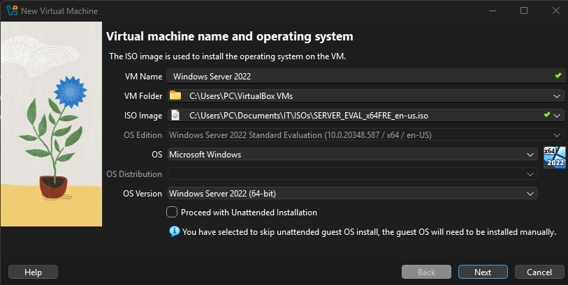

4. Click Next or **Specify virtual hardware** and **Specify virtual hard disk**
5. Allocate your resources according to your specs and proceed

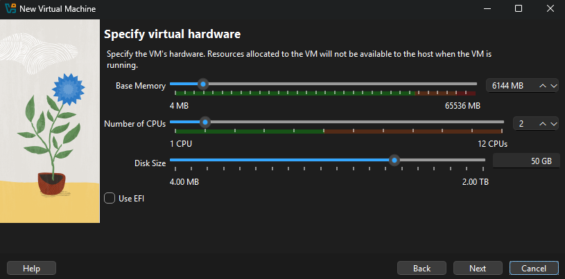

6. Click Next
7. Click Finish

### Configure VirtualBox Network Settings

In order for the VM-to-VM communication to work, we need to configure their network setting to Internal Network.

This allows VM-to-VM communication, with each VM behaving as if they are connected to the same switch.

1. Right-click on the VM
2. Click Settings
3. Click Expert
4. Click Network  
5. In the Attached To field, select Internal Network 
6. Click OK

See image below for assistance.

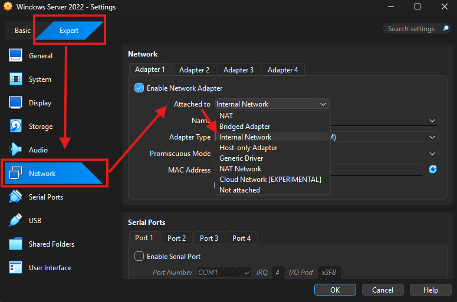

### Initial OS Setup

After configuring the virtual machine's settings in VirtualBox, you will need to proceed through the Microsoft Server Operating System Setup.

From VirtualBox:

1. Right-click on the Windows Server VM
2. Click Start

In the VM:

3. Click Next, and then Install
4. Select Windows **Server 2022 Standard Evaluation (Desktop Experience)**
    - This is important. Make sure that you select the correct Operating System
    - If you ever need to return to the previous screen, click the left arrow icon on the top left of the screen
5. Click Next
6. Acccept the Microsoft Software License Terms and click Next

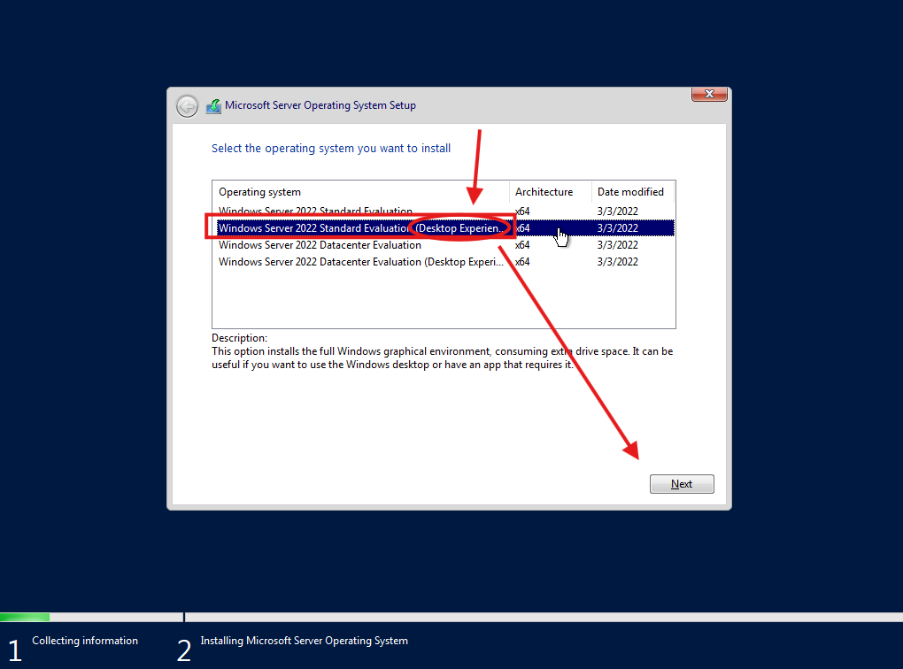

7. Click "Custom" installation

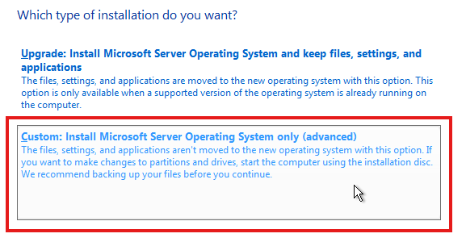

8. Choose the drive in which you want the OS installed, then click Next

The Windows Server operating system should begin the installation process,

Afterwards, you will be taken to the Customize Settings screen.

9. Create and take note of a password for the operating systems's built-in administrator account

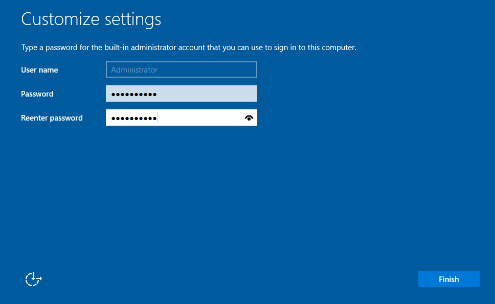

### Renaming the Server

I strongly recommend changing the name of the server too, as I will be using the name **"DC01"** in this lab.

To rename the server, you will need to use VirtualBox's version of Ctrl + Alt + Del. This should be your specified Host key (right Ctrl by default) + and the Del key. 

From the Windows Server lock screen:
1. Host + Del
2. Enter your Administrator password
3. Open the Server Manager application
4. Click on Local Server in the left window pane
5. Click the Computer Name

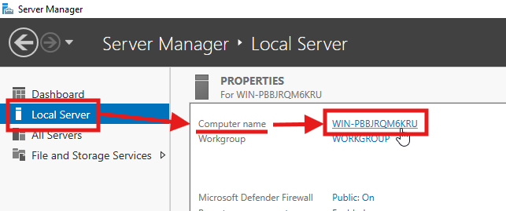

6. Click Change  
7. Set name to: **DC01**\
8. Click OK

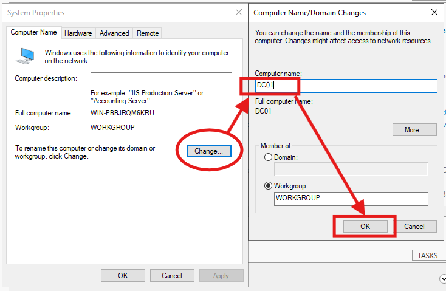

8. Restart the Windows inside of the VM (Do not close or shut down the VM through VirtualBox)

You should see the Local Server under a new computer name now.

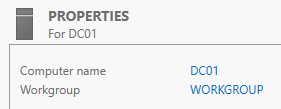

---

## 2️⃣ Configure Server Network Settings

At this point, your server does not have the capability to recieve an IP address from a DHCP server.

This can be confirmed by using the `ipconfig` command in the Command Prompt.

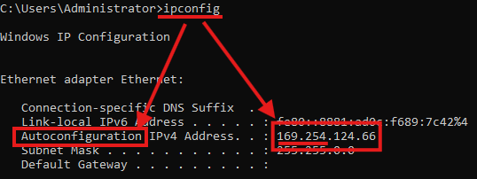

If your IPv4 Address is preceded by the word "Autoconfiguration", or is followed by an IP address that starts with 169.254.X.X, then your device is using an APIPA address and you will need to assign your device's IPv4.

```
Note: A device uses an (Automatic Private IP Addressiing) address (169.254.X.X) to assign itself an IPv4 address when it cannot automatically obtain an IPv4 through a DHCP server.

Since an IP address cannot be automatically obtained by out Windows Server VM, we have to assign our own in this scenario.
```


1. Press Win + R and type: **ncpa.cpl**
2. Right-click on your Ethernet adapter
3. Click Properties
4. Select Internet Protocol Version 4 (TCP/IPv4)
5. Click Properties
6. Click **Use the following IP address**
7. Set the following:

    - IP address: `172.16.0.10`  
    - Subnet mask: `255.255.0.0`  
    - Default gateway: (leave blank for now)  
    - Preferred DNS: `127.0.0.1`  

```
Note:

You might be asking, "Why is the DNS set to 127.0.0.1?"

- This IP address is the loopback interface so the server will point to itself when a DNS query is made on the network instead of asking a router or external server/device
- Servers running Active Directory also act as DNS servers, and this one is no different
- The server will resolve domain names using its own records for all devices involved in the simulation
```

After running the `ipconfig /all` command in Command Prompt, your Host Name, IPv4 Address, Subnet Mask, and DNS Server configurations should look something like this.

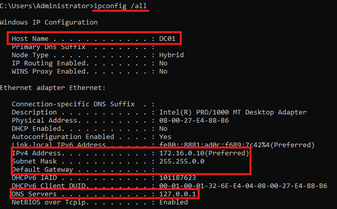

---

## 3️⃣ Install Active Directory & Promote to Domain Controller

From Server Manager:

1. Click Manage
2. Click Add Roles & Features
3. Proceed through the menu until you reach the Server Roles page
4. Choose Active Directory **Domain** Services
    - Do NOT choose Active Directory Certificate Services

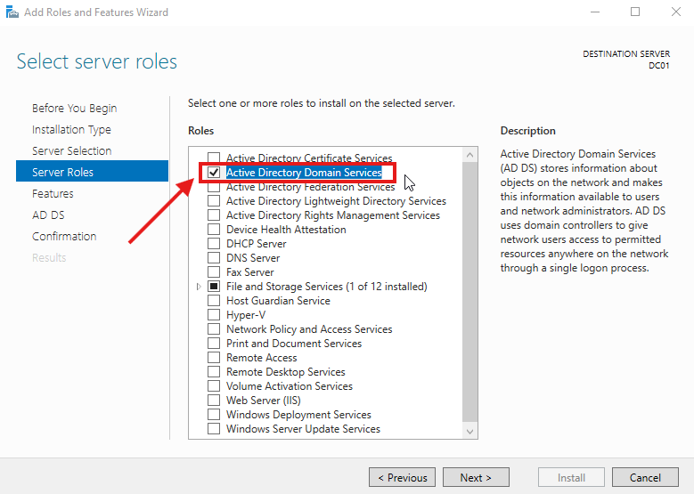

5. Click Add Features
6. Proceed through the menu until you reach the Confirmation page
7. Click Install and wait for ADDS to finish installing
8. Click **Promote this server to a domain controller**

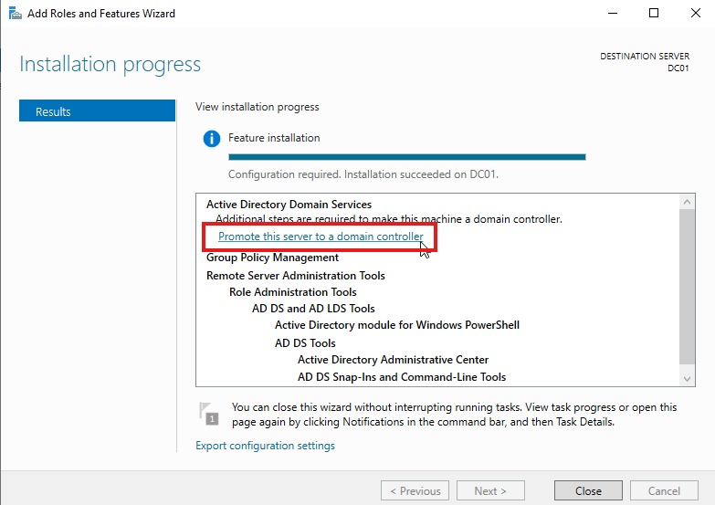

9. Click **Add new forest**
10. Domain name: **[yourname].com**
    - For example, I chose "Craig.com"

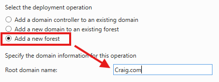

```
Note: The domain name you choose is the name of the logical group of all objects within your network. This windows server, being a domain controller, will host ADDS amd manage security, policies, and other data for hosts on the domain (Craig.com for instance).
```
11. Click Next, then set and take note of a DSRM password
    - This is essentially the Domain Contoller's password.

12. Complete the installation through clicking Next in each of the following screens, and then Install when available

Your Windows Server operating system should restart by itself upon ADDS installation.

---

## 4️⃣ Windows 11 Client VM Setup

From the VirtualBox Machines screen:

1. Ctrl + N or click New
2. Uncheck "Proceed with Unattended Installation"
3. Fill out the fields according to the table and image below:

| Field | Entry |
| --- | :--- |
| VM Name | "Windows 11 Client" or whatever name you'd prefer |
| ISO Image | *(Select yout ISO's directory)* |
| OS | Microsoft Windows |
| OS Version | Windows 11 (64-bit) |

Your initial settings should appear similar to the following image.

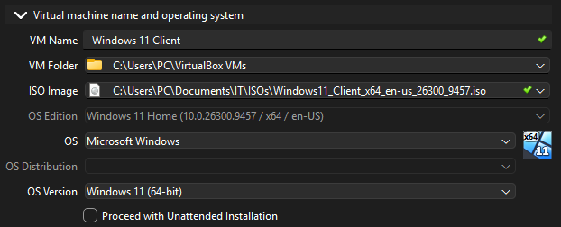

4. Click Next or **Specify virtual hardware** and **Specify virtual hard disk**
5. Allocate your resources according to your specs and proceed

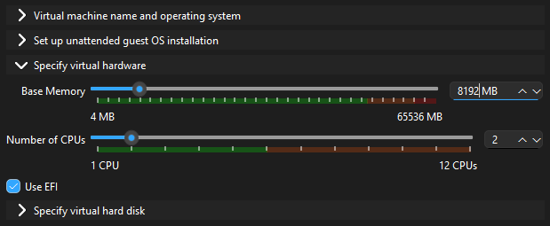

```
The Windows 11 operating system requires at leat 70-80 GB of space to boot properly.
```

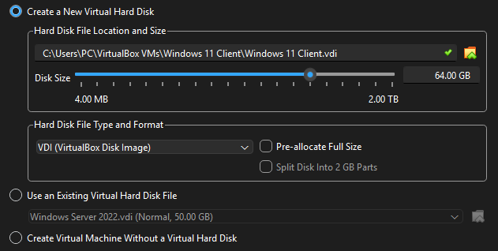

6. Click Next/Finish

### Configure VirtualBox Network Settings

The VM will need to have its VirtualBox network settings configured the same way as the Windows Server VM.

1. Right-click on the VM
2. Click Settings
3. Click Expert
4. Click Network  
5. In the Attached To field, select Internal Network 
6. Click OK

### Initial OS Setup

After configuring the virtual machine's settings in VirtualBox, you will need to proceed through the Microsoft Server Operating System Setup.

From VirtualBox:

1. Right-click on the Windows Server VM
2. Click Start
3. If you are presented with the following pop-up, you likely have to allocate more resources (specifically hard disk space!) to the VM

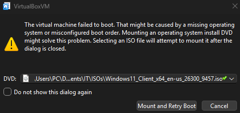

4. Proceed through the Windows 11 Setup until you are prompted for a product key
5. Click **I don't have a product key**
6. Select **Windows 11 Pro** and proceed

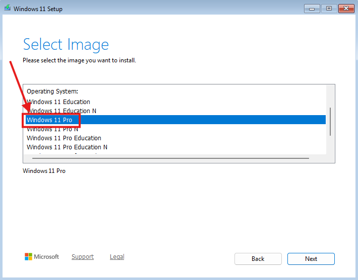

7. Proceed with installation
8. After the installation is complete, proceed through the second setup
9. Name your device, then click Next

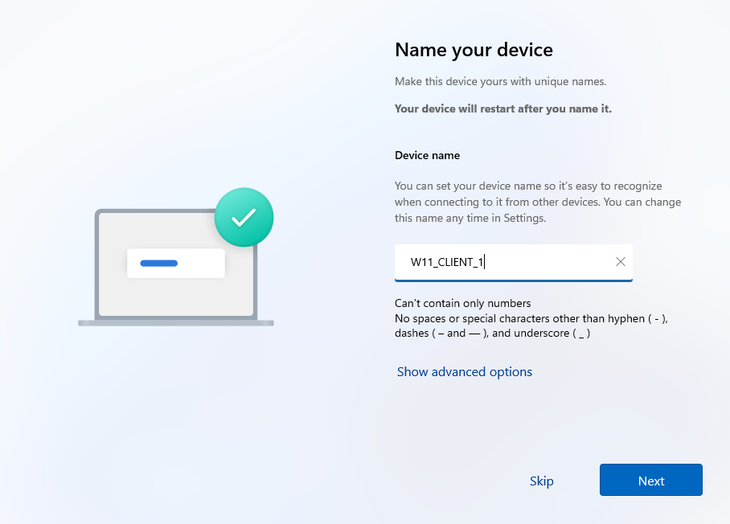

10. Click **Set up for personal use**, then Next
    - This will allows you to practice AD in the simulation without needing an organizational account.

When prompted to sign into a Microsoft account:

11. Click **Sign in**
12. Click **Create one!** (Getting to the "Create account" screen is important!)
13. Press `Shift + F10` to open the Command Prompt
14. Enter the command: `start ms-cxh:localonly`

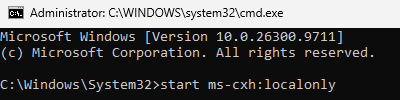

```
This will bypass the mandatory Microsoft sign-in and internet connection. Remember, this lab will be hosted locally.

Note: YOU MAY NEED TO USE ALT + TAB TO FIND THE NEW WINDOW THAT OPENS AFTER RUNNING THE COMMAND.
```
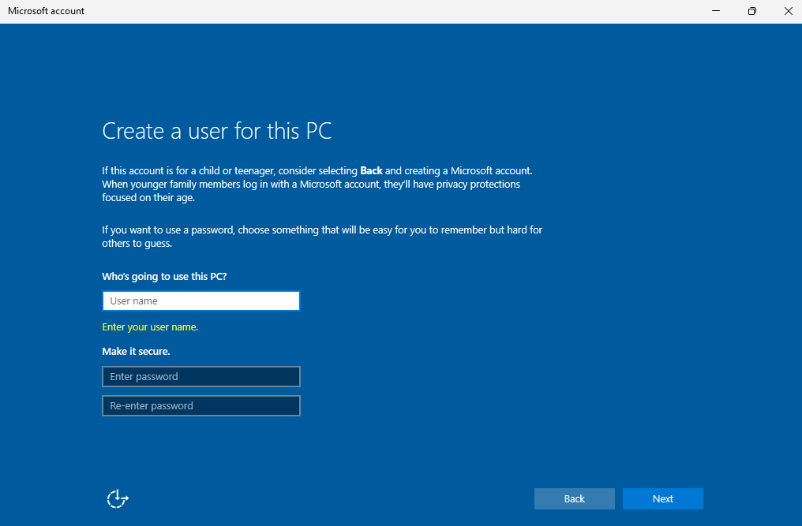

15. Create local account:
    - Username: clientuser
    - Password: clientuser or leave it blank for now

16. Accept all prompts and finish setup   

---

## 4.5 Windows 10 Client VM Setup (If you use Windows 10 instead of Windows 11)

From the VirtualBox home screen:

- CTRL + N  
- Name: Windows 10 Client

- Allocate resources  

Configure Network:
- Settings → Network → Internal Network  

Continue setup:
- Load Windows 10 ISO  
- Choose: Windows 10 Pro
- Select Custom install  
- Proceed through setup  

When prompted:
- Select **Set up for personal use**  
- Choose:
  - Offline Account  
  - Limited Experience  

Create local account:
- Username: clientuser
- Password: clientuser
- Accept all prompts and finish setup  

---

## 5️⃣ Configure Client Network Settings

We need to manually configure the Windows client's IPv4 settings so that it can recieve a static address and also reach the Windows Server 2022 VM.

On the client VM:

1. Press Win + R and type: **ncpa.cpl**
2. Right-click on your Ethernet adapter
3. Click Properties
4. Select Internet Protocol Version 4 (TCP/IPv4)
5. Click Properties
6. Click **Use the following IP address**
7. Set the following:  

    - IP address: `172.16.0.20`  
    - Subnet mask: `255.255.0.0`  
    - Default gateway: (leave blank)  
    - Preferred DNS: `172.16.0.10`  

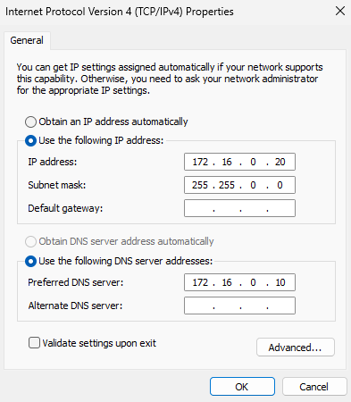

Why did we configure the IPv4 settings this way?

- The client must use the Domain Controller's IP address (172.0.16.10) as its DNS so that once it is joined to your domain, it can locate the domain itself as well as other devices belonging to it.

- For Example (A DNS query in layman's terms):
  1. Client asks, "Where is Craig.com?" to every device reachable by broadcast  
  2. Server asks itself a similar question, (it asks itself because its DNS is set to a 127 loopback address, so it points to itself to resolve DNS queries) "What IP address is Craig.com in?"
  3. The server responds to the client with the correct IP Address (its own IP address) found in its DNS cache or authoritative zone.
  4. Domain join succeeds

```
Note: If you want to create any other client VMs, I recommend using the same addressing scheme, but use a different IP address that wasn't used already. For instance 172.16.0.30 or 172.16.0.40 should work fine as long as their DNS is set to the IP address of the domain controller with AD DS + DNS capabilities and the machine is joined to the domain. (Shown below in Part 7 of this document)

Keep note of the addresses of you do create more VMs!
```

---

## 6️⃣ Verify Connectivity

1. Open Command Prompt in the Windows client and run: `ipconfig /all`
2. Confirm correct IP configuration
3. Run `ping 172.16.0.10` to see if your host is reachable
- The coniguration and ping attempt should appear as the following. All 4 packets should be received  .

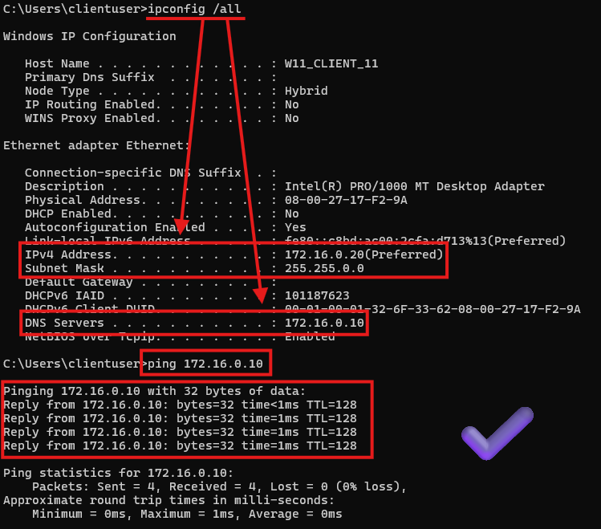

If you see: "Destination host unreachable", ensure both VMs are on Internal Network through VirtualBox's network settings

```
If you still cannot ping the windows server VM from the windows client VM, try rechecking the IPv4 configuration on both VMs, and then waiting a few minutes
```

---

## 7️⃣ Join Client to Domain

In the last step of the setup, the client Windows 10/11 VM needs to be joined to the domain. 

In order to do so perform the following inside of the client VM.

1. Open Settings
2. Click **System**
3. Scroll to the end and click **About**
4. Click **Domain or workgroup**
5. Click **Change...**

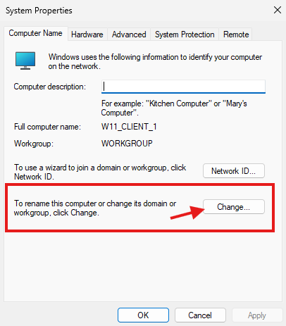

6. Click Domain
7. Enter your domain name, or use the assigned static IP Address of your server 
    - Both work because your DNS is already configured

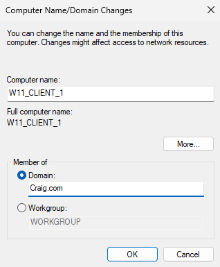

8. When prompted, enter the Administrator login information that you created on your domain controller earlier.

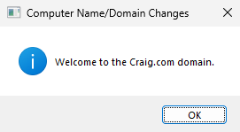

---

## 8️⃣ Verify Domain Join

Verify that the client VM has been successully joined to your domain.

From the Windows Server VM:

1. Open Server Manager
2. Click Tools
3. Click Active Directory Users and Computers
4. Expand your domain on the left pane in the GUI
5. Click Computers

If the client appears, you are good to go!

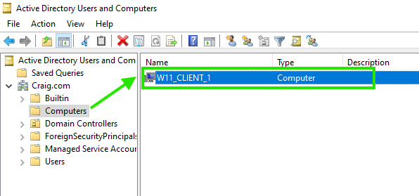